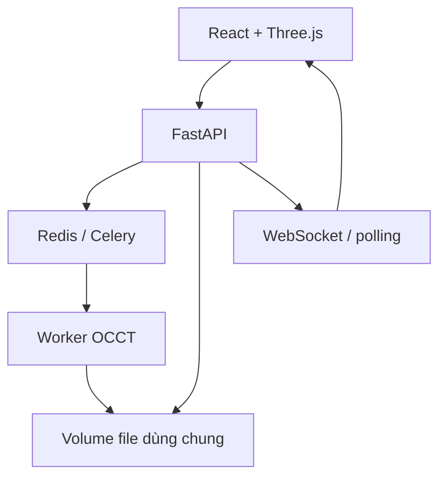

# Kiến trúc bản 0.1

## Ranh giới trách nhiệm

| Tầng | Hiện có | Giai đoạn sau |
|---|---|---|
| Frontend | React, Three.js, Web Worker, split view, lỗi và download | LOD, chọn từng vùng lỗi, lịch sử job |
| API | API key, streaming upload, task ID, job capability token, WebSocket | OIDC, quota theo người dùng, giới hạn tổng queue |
| Điều phối | Celery prefork, Redis, một task/process, timeout, Beat cleanup | Queue CPU/GPU riêng, retry có kiểm soát |
| Geometry | trimesh + NumPy, OCCT qua cadquery-ocp | Region growing, fitting trụ/cầu/nón, giao tuyến, NURBS |
| Lưu trữ | Docker volume chung một VPS, TTL logic + dọn hàng giờ | S3/MinIO, presigned upload, object lifecycle |
| AI | Chưa tích hợp | Adapter model riêng; chỉ bật sau benchmark hình học |

OCCT qua `cadquery-ocp` được dùng trực tiếp thay vì cài đồng thời FreeCAD và pythonocc-core. Đây là binding OCCT, không phải runtime FreeCAD. Giữ một hạt nhân CAD giúp đơn giản hóa bản đầu; có thể thêm worker FreeCAD riêng khi cần.

## Luồng hình học

1. Nạp STL không xử lý ngầm; kiểm tra số mặt, giá trị hữu hạn và scale.
2. Hợp nhất đỉnh trùng chính xác để STL có topology cạnh. Báo cáo trước sửa dùng index của lưới đã hợp nhất này, không phải index byte trong STL.
3. Chẩn đoán cạnh hở/phi đa tạp, mặt suy biến/trùng, hướng mặt. Báo cáo mỗi loại có vùng bao XYZ; index chi tiết bị giới hạn 5.000 phần tử để tránh báo cáo khổng lồ. Chưa gom các lỗi kề nhau thành từng vùng riêng.
4. Loại mặt suy biến với ngưỡng rất nhỏ tương đối theo kích thước, bỏ mặt trùng, sửa hướng nhất quán. Giữ STL gốc. Không hàn đỉnh gần nhau, vá lỗ hay tái chia lưới.
5. Chỉ nhận lưới kín và hướng mặt nhất quán. Tách thành phần **không bật sửa lỗ ngầm**. Từ chối thành phần có vùng bao giao nhau để tránh đoán sai cavity/assembly.
6. Dựng các mặt tam giác, sewing theo dung sai `max(1e-7, diagonal*1e-9)` trong đơn vị nguồn, tạo solid.
7. Tùy chọn `ShapeUpgrade_UnifySameDomain`: gộp mặt đồng phẳng với dung sai góc rất nhỏ. Không biến dãy mặt bên của trụ thành cylinder.
8. BRepCheck, thể tích dương, số solid, bounds; xuất AP214 rồi nhập lại. Sai lệch thể tích tương đối tối đa `1e-5`, bounds tối đa 20 lần dung sai sewing. Các chỉ số này chưa thay thế sai lệch bề mặt hai chiều.
9. Tessellate STEP đã nhập lại để xem trên web. Đây là dữ liệu hiển thị; file tải về vẫn là STEP B-rep thật.

## Trạng thái và lỗi

`queued → running → completed | failed`. Các mốc tiến độ mô tả từng bước, không phải ước lượng thời gian tuyến tính. JSON trạng thái được ghi bằng atomic rename. Job UUID và token ngẫu nhiên độc lập; token đi qua header download/status và frame đầu WebSocket, không xuất hiện trên URL. UUID đơn thuần không cấp quyền đọc file.

Nếu worker chết cứng, API đánh dấu job quá hạn khi metadata không cập nhật sau timeout + 60 giây. Bản đầu không retry tự động conversion. Redis persist AOF; task được acknowledge sớm nhằm tránh chạy lại CAD không giới hạn sau crash. Nếu toàn máy chết cần khởi động lại stack và gửi lại job lỗi.

Một job hết hạn truy cập sau 24 giờ tính từ lúc tạo; Beat xóa file trong lượt dọn hàng giờ kế tiếp. Redis result cũng hết hạn. TTL không phải bảo đảm xóa vật lý đúng từng giây.

## Tích hợp AI sau này

Điểm mở rộng nên là `segment_and_fit(mesh) -> patches + boundary candidates + confidence`. Mỗi patch phải qua kiểm tra residual, adjacency, giao tuyến và sai lệch so với mesh trước khi thành CAD. AI không được tự đánh dấu solid hợp lệ.

- PointNet/PointNet++ cần tập huấn luyện và nhãn phù hợp cho phân loại cơ khí/hữu cơ; không mặc định mọi model có sẵn đều hỗ trợ nhãn này.
- ParSeNet cung cấp surface patches; vẫn cần topology reconstruction, trimming, sewing.
- BRepNet làm việc trên B-rep có topology; không dùng trực tiếp để phát hiện cạnh từ STL.
- Quadric decimation không phải quad-remeshing; organic → quad/SubD/NURBS là một nhánh riêng.
- GPU chỉ là yêu cầu của adapter inference được lựa chọn, không phải điều kiện của CPU pipeline hiện tại.

Tham khảo nguồn gốc: [BRepNet](https://github.com/AutodeskAILab/BRepNet), [ParSeNet](https://github.com/Hippogriff/parsenet-codebase), [Point2CAD](https://github.com/prs-eth/point2cad), [OCCT](https://github.com/Open-Cascade-SAS/OCCT). Cần kiểm tra giấy phép/checkpoint và benchmark riêng trước khi tích hợp cho dịch vụ thương mại.
